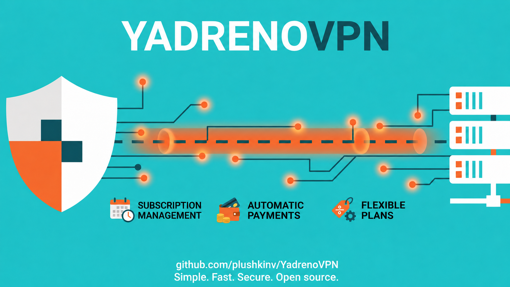

<table align="center">
  <tr>
    <td align="center" width="300"><h1><a href="README.MD"><br>Русский</a></h1></td>
    <td align="center" width="300"><h1><a href="README.en.md"><br>English</a></h1></td>
  </tr>
</table>

<p align="center">
  
</p>

<h1 align="center">A Telegram bot for automating your VPN business with 3x-UI</h1>

<p align="center">
  <b>Accept payments, deliver subscriptions and manage users — while you sleep.</b>
</p>

<p align="center">
  <a href="#1--creating-a-vps-server">🚀 Create a server</a> •
  <a href="#2--installation-and-startup">🛠️ Installation</a> •
  <a href="#3--promotion-and-updates">📈 Promotion</a> •
  <a href="#4--using-the-bot">🤖 Guides</a> •
  <a href="#-questions-and-discussion">💬 Discussion</a>
</p>

---

## ✨ Features

| 🛡 Bot features | 💳 Payments and finance |
| :--- | :--- |
| ⚡ **Installation and setup in 3 clicks** (our main advantage!)<br><br>🚀 **All popular protocols:** VLESS (Reality, WS, gRPC), VMess, Trojan, Shadowsocks<br>🎁 **Trial subscriptions:** a configurable free trial for new customers<br>📂 **Server groups and plans:** flexible subscription tiers, such as Basic and Premium<br>🌍 **Multiple servers in one subscription:** through a 3x-ui master panel and nodes<br>🔗 **Referral program (up to 3 levels):** rewards as bonus days or internal account credit<br>🎟 **Promo codes, promotional links and coupons:** discounts, campaign tracking and single-use codes<br>🔔 **Smart broadcasts and automatic notifications:** subscription expiry reminders<br>👥 **Full control:** server statistics, limit resets and key management directly in the Telegram admin panel | 💰 **Payment options:**<br>• 💳 **Cards and SBP:** YooKassa, Cardlink, WATA, Platega<br>• 🪙 **Cryptocurrency:** CryptoBot (USDT, TON and more)<br>• ⭐ **Telegram Stars and TG Payments**<br>• 🌐 **NOWPayments, Stripe, PayPal, PayTabs, MyFatoorah**<br><br>💱 **RUB/USD base currency:** one plan price with automatic amount calculation for payment methods<br>🛒 **Unified internal balance:** user top-ups are available through customization and are not enabled in the default menu<br>💎 **Split payments:** cover part of the price with account credit and pay the remainder using a convenient payment method<br>🔄 **Full automation:** automatic instant subscription delivery and renewal<br>📊 **Clear statistics:** detailed sales and revenue reports<br>👥 Individual referral multipliers for partners and manual balance management |

<br>
<h2 align="center">
  <a href="https://t.me/YadrenoAdmin_Bot">🚀 Order a turnkey installation from ₽500</a>
</h2>
<p align="center">
  <b>VPN server setup + VPN panel + sales bot, all connected and ready to work together!</b>
</p>
<p align="center">
  <sub><i>The service is performed automatically by the YadrenoAdmin AI agent, without the author's personal involvement. A successful result is not guaranteed.</i></sub>
</p>
<br>

## 🎥 Video tutorials and overviews

For a quick start and an introduction to the system's features, watch these tutorials by the author. **All videos are in Russian (Russian-language videos).**

* 🎬 [**Your own VPN in 5 minutes for $2 + deploying a Telegram bot**](https://www.youtube.com/watch?v=x987fH1t-nk) — A step-by-step guide to creating and launching a personal VPN server with a 3x-ui panel and integrating a Telegram bot for automated sales from scratch.
* 🤖 [**Turnkey VPN service: an AI agent does everything for ₽500**](https://www.youtube.com/watch?v=Bjb56K5FV0Q) — How to launch a VPN business automatically using our AI agent, which connects 3x-ui and the Telegram bot for you.
* ✨ [**YadrenoVPN's main advantage: customization and the AI agent**](https://www.youtube.com/watch?v=ACPu03aAJns) — A demonstration of customizing the bot's interface, buttons, text and prices with plain-language requests to the AI agent.
* 🌍 [**Multiple VPN servers in one subscription: master panel and nodes**](https://www.youtube.com/watch?v=BXV_KHdnrZc) — A technical guide to scaling your VPN network: configuring a shared 3x-ui control panel and connecting remote nodes in different countries.

---

## 1. 🚀 Creating a VPS server

**Recommended hosting:** [VDSina](https://www.vdsina.com/?partner=y7b4tz6w9mgf) — a 10 Gbps connection and one-click VPN installation.

### Step 2: Create a VPS server

1. In your hosting account, click **"Создать сервер" (Create server)** and select **3X-UI VPN**.
2. Choose a **location** — for a VPN, a **data center abroad** such as Amsterdam or Frankfurt is preferable.
3. Choose a **plan** — the minimum configuration is enough to start:
   - **1 vCPU**
   - **1 GB RAM**
   - **10 GB SSD**

   > This is enough for approximately 20–50 simultaneous VPN users.

4. Click **"Создать" (Create)** and wait for the server to start, usually 1–2 minutes.
5. Once it is created, you will receive:
   - the server's **IP address**;
   - a **username**, usually `root`;
   - an **SSH password**;
   - a link to the 3X-UI VPN control panel, such as `https://[IP_ADDRESS]/secret/`.

## 2. 🛠️ Installation and startup

The fresh-installation instructions target Ubuntu 24.04. The web editor's builder supports Ubuntu 22.04 and 24.04; this compatibility fix does not require upgrading an existing server's OS.

Connect to the server over SSH and run this command:

```bash
bash <(curl -sL https://raw.githubusercontent.com/plushkinv/YadrenoVPN/main/install.sh)
```

Select **1) 🚀 Установка (Installation)**, then choose a language with ↑/↓ and Enter (or a number in a basic terminal). Russian is selected initially; selection waits for your confirmation. Enter your bot token and Telegram ID, and the script will automatically:

- update system packages;
- download the GitHub repository;
- create a virtual environment and install Python dependencies;
- configure automatic bot startup and register the maintenance updater template in systemd;
- start the bot.

Installation and reinstallation select the latest stable version: commits whose subject starts with `?` are skipped. For unattended installation as root, including installation by an agent, pass the token and ID in a single command without prompts:

```bash
bash <(curl -fsSL https://raw.githubusercontent.com/plushkinv/YadrenoVPN/main/install.sh) install 'BOT_TOKEN' 'ADMIN_ID' --language en < /dev/null
```

Available codes: `ru`, `en`, `fa`, `ar`, `es`, `id`, `ja`, `pt`, `sk`, `tr`, `vi`, `zh-CN`, `zh-TW`. Without `--language`, a fresh unattended installation uses Russian. One language applies to the bot, admin panel, website and Mini App; there is no built-in switch after installation. Updates and reinstallation preserve the language and your texts. The ready website archive includes all dictionaries; choosing a language requires no rebuild.

To update the bot, run the script again and choose:

- **2) 🔄 Мягкое обновление (Soft update)** — a safe fast-forward update; tracked project files must have no local changes.
- **3) ⚠️ Жёсткая перезапись (Hard overwrite)** — directly overwrite the code from GitHub without automatic rollback; `config.py`, bot data, the verified manual rollback point and the `backup/` directory are preserved.
- **4) ↩️ Откат обновления (Roll back an update)** — select one of the three most recent available versions and restore the corresponding database backup using the snapshot's standalone runner.

Soft update and hard overwrite also select a stable version by default. The commands `update [COMMIT_OR_BRANCH]` and `reset [COMMIT_OR_BRANCH]` accept an explicit target, including a beta; both run without prompts. For an older installation, use the current script from GitHub.

Interactive menu item 4 lists available versions and commits and requires separate confirmation of losing changes made after the chosen backup. To roll back unattended to an already selected snapshot, use `bash install.sh rollback SNAPSHOT_ID < /dev/null`: this command applies the snapshot without further questions.

> 💡 Administration of an installed bot is covered in the [administrator guide](ADMIN_GUIDE.en.md); advanced customization through the agent is covered in the [YaAdmin guide](YAADMIN_GUIDE.en.md).

## 3. 📈 Promotion and updates

### Automatic marketing

Add the [Ya.Footer](https://yadreno.ru/footer/) bot to your Telegram channel. It automatically adds a button or link to your VPN bot to each of your posts. This can significantly increase your sales! 🚀

### Keeping up with updates

Subscribe to the [Ядрёно.ру](https://t.me/YadrenoRu) channel for bot updates, new features and bug fixes. We recommend checking for updates regularly and installing them through the bot's admin panel.

---

## 4. 🤖 Using the bot

Detailed information about the admin panel and the built-in agent is available in separate documents:

👉 **[Administrator guide](ADMIN_GUIDE.en.md)**

👉 **[YaAdmin / Yadreno Admin guide](YAADMIN_GUIDE.en.md)**

---

## 💬 Questions and discussion

Example of a working bot: https://t.me/Yadreno_VPNbot

For questions about the bot or its deployment, contact https://t.me/YadrenoAdmin_Bot — it can answer your questions and install everything for you!

For human support or suggestions about the bot's development, join the private chat through https://t.me/YadrenoAdmin_Bot.

_The chat also covers:_

- advertising;
- improving protocol configuration;
- working around allowlists;
- and much more.

---

## 👤 Author and support

**Developer:** [Plushkin Blog](https://t.me/plushkin_blog)

I am raising funds to develop an MMORTS game with a fair economy and no pay-to-win. Players will not be able to buy anything from the game's author: no exclusive items or unlimited resources for wealthy players.

Your support is much appreciated — even ₽100 helps. Every contribution counts! ;)

💳 **Russian bank cards:** https://yoomoney.ru/fundraise/1GJ73GGRJBC.260318
💰 **USDT (TON/BSC/ARBITRUM):** https://t.me/Ya_SellerBot?start=item-40
